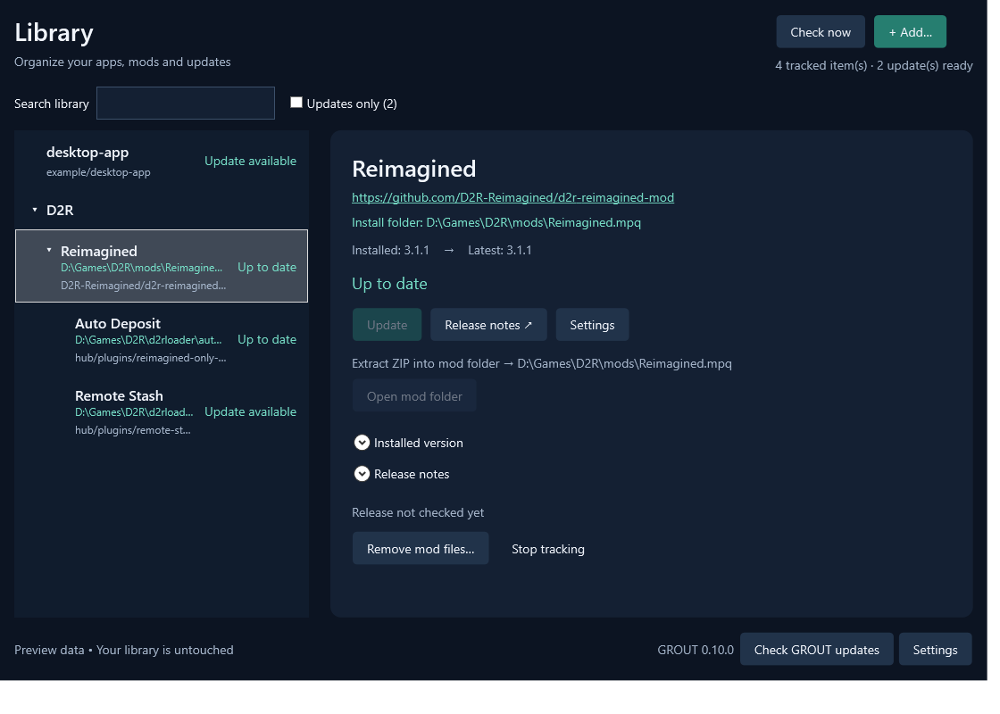

# G.R.O.U.T.

**Git Release Observer & Update Tool**

The updater your apps are missing.

Great apps on Git repositories do not always include an updater. GROUT fills that gap on Windows: track apps you already have, or install new ones from releases on **GitHub, Codeberg.org and GitLab.com**.

**[Download GROUT.exe for Windows x64](https://github.com/sirkuttin/GROUT/releases/latest)** · [User guide](docs/user-guide.md) · [Report a bug](https://github.com/sirkuttin/GROUT/issues)

*GROUT 0.5.2 with sample data.*

## What it does

- **Watches releases** on three supported hosts, with optional preview releases.
- **Updates your way:** run an installer, replace a portable EXE, extract a ZIP, or download for manual installation.
- **Tracks installed versions** from EXE metadata or manifests, with manual tracking when needed.
- **Stays out of the way:** scheduled checks, tray notifications, quiet mode and optional start at sign-in.
- **Finds missing installations:** locate a moved app or stop tracking one you removed.
- **Updates itself** from this repository's stable releases after you choose **Update and restart**.

## Get started

1. Download **GROUT.exe** from the [latest release](https://github.com/sirkuttin/GROUT/releases/latest), save it in a permanent writable folder, and run it.
2. Choose **Add App**, paste a supported repository or release link, then choose to track an existing app or install it.
3. Choose the Windows download and how updates should work. GROUT shows the destination before applying file updates.

The Windows x64 download is a **single portable EXE** with .NET included. No installer, adjacent DLLs or separate .NET installation is required. Your library and settings live in AppData; see [storage and cleanup](docs/user-guide.md#storage-and-cleanup).

> **Early release:** the EXE is currently unsigned. Close third-party apps before updating their files. File updates start when you choose Update; external installers and GROUT self-updates have their own confirmation. Features on `main` may be newer than the latest release.

## Learn more

| Guide | What's inside |
| --- | --- |
| [Using GROUT](docs/user-guide.md) | Adding apps, update methods, versions, startup, uninstall and storage |
| [Supported sources](docs/supported-sources.md) | Accepted links, previews, Windows download filtering and limits |
| [Troubleshooting](docs/troubleshooting.md) | Missing apps, disabled updates and interrupted operations |
| [Development](docs/development.md) | Build from source, packaged tests and diagnostic commands |
| [Publishing releases](docs/releasing.md) | The C# script and verified GitHub publishing workflow |

## License and security

[MIT licensed](LICENSE). License notices are included in the EXE and available in **Settings → Licenses and third-party notices**.

Report ordinary bugs through [GitHub Issues](https://github.com/sirkuttin/GROUT/issues). For vulnerabilities, follow [SECURITY.md](SECURITY.md).