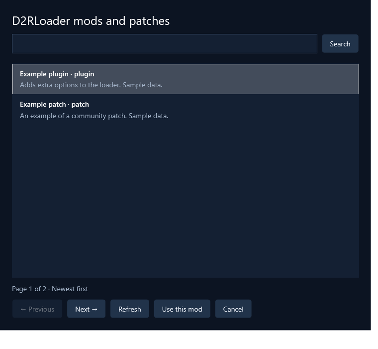

# D2RLoader mods

[← Back to README](../README.md) · [ZIP contents selection](user-guide.md#install-part-of-a-zip)

Available in local 0.8.0 builds. The provided public API works without an API key.

## Add a mod

Paste either form into **Add App**:

```text
https://d2rloader.net/hub/plugins/more-merc-items
https://d2rloader.net/api/v1/hub/plugins/more-merc-items
```

Both identify the same library entry. Choose to track an existing installation or install from a ZIP. The mod's name appears in the library; its source page is linked beneath it.

Alternatively choose **Browse D2RLoader…**. The browser shows public mods and patches, newest first, with Search and Previous/Next controls. Search uses the API q parameter. Press Enter or Search; searches restart on page 1, and paging retains the query. Clear the field and search again to return to all items. It requests a page only when needed. Select a row and choose **Use this mod** to fill the Add App link.



## Install and update

ZIP releases use GROUT's existing extraction flow. **Choose ZIP contents…** lets you install the entire ZIP, one folder's contents, or one file. Choose the destination appropriate to your D2RLoader setup. For an existing exact destination use **App settings → App folder**; a first install creates an app-named folder under the selected parent.

Matching destination files are overwritten. The saved ZIP selection is reused on future updates; a missing selected path stops before installed files change. Completed downloads, staging and transient rollback are cleaned up.

Standalone DLL and JSON releases are offered as **Download only**. Copy them to their required location yourself, then recheck or mark the version installed. Automatic raw-DLL placement is not included in this version.

GROUT tracks and delivers files. Configure D2RLoader and enable its mods/plugins separately.

## Release information

GROUT checks the individual mod detail API for updates. It selects a public mod's newest published release by publication time; editing an older release does not make it the latest version. Drafts and future publications are excluded. The preview option includes versions with common beta/preview markers.

Installed versions are read from the top-level `name` in `manifest.json`: `RuffnecKk-remote-stash-v2.3.4` reports version `2.3.4`. Names without the v marker also work: `d2rl-auto-deposit-0.1.4` reports `0.1.4`. The top-level numeric `version` is a manifest schema version and is ignored. D2RLoader mod folders containing this manifest are installed without trailing version suffixes: `d2rl-auto-deposit-0.1.4` becomes `d2rl-auto-deposit`. The manifest contents are kept intact. A remembered ZIP selection can follow a unique matching folder whose version suffix changed; ambiguous matches stop for reselection. Existing versioned folders are not automatically renamed.

The release ID builds the download endpoint. GROUT verifies the exact byte size and SHA-256 supplied by the API. Loader-version requirements are shown in release notes and during initial lookup. Scan detections and moderator review context appear on the affected app and before a new install.

D2RLoader API rate limits pause that source while other providers continue normally.

## Verification

The automated provider tests cover URL aliases, release selection, hashes, unsafe metadata, source warnings, pagination, the real browser selection flow and ZIP installation through the shared pipeline. Public API metadata reads succeeded. The separate live-network diagnostic launched through GROUT was blocked by automatic approval review and is not included in the verified results.
