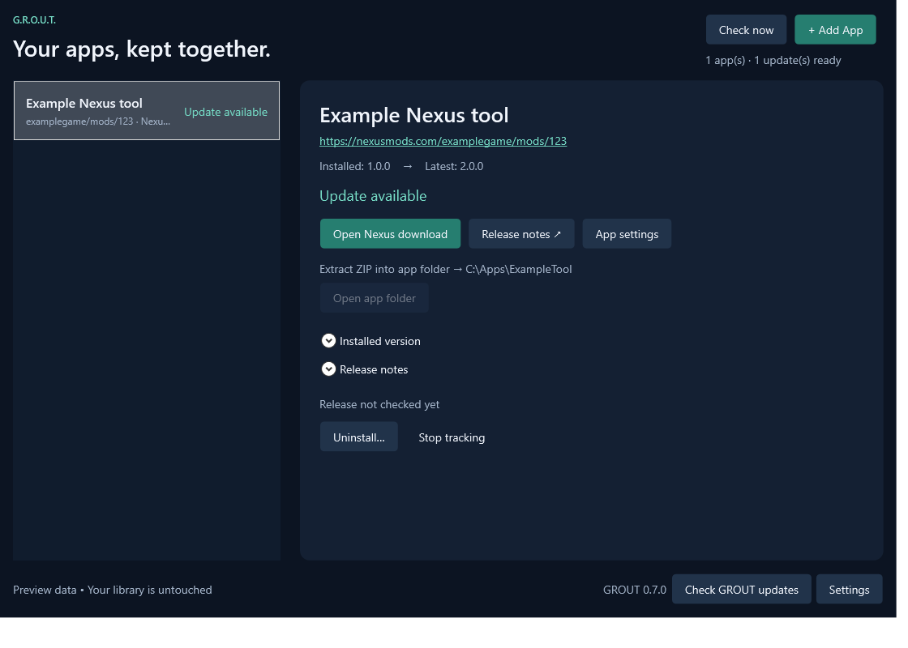

# Nexus Mods — testing integration

[← Back to README](../README.md) · [Supported sources](supported-sources.md)

Disabled in public 0.7.1 builds. For a private testing build, use `dotnet build ReleaseDock/ReleaseDock.csproj -c Release -p:NexusTestingEnabled=true -o outputs/nexus-test`. The release script always disables Nexus. The setup instructions below apply only to an explicitly enabled test build. GROUT must be registered with Nexus before this integration is offered to a wider public audience. Personal API keys are intended for testing/personal use under the [Nexus API policy](https://help.nexusmods.com/article/114-api-acceptable-use-policy).

## Connect

1. Open **Settings → Nexus Mods connection…**, or **Connect Nexus Mods…** in Add App.
2. Choose **Open Nexus API access** and generate your own personal key on Nexus for testing. Do not use a key issued to another app.
3. Paste it into the masked API-key field and choose **Connect**. GROUT validates the account and shows whether it has Premium.
4. Add a Nexus mod-page URL, for example `https://www.nexusmods.com/diablo2resurrected/mods/169`.

The key is encrypted with Windows DPAPI for your Windows user and stored in `%LOCALAPPDATA%\ReleaseDock\nexus-connection.bin`. It is not placed in the library/settings JSON, passed on the command line or forwarded to download hosts. **Disconnect** deletes the connection. Reconnect after changing account membership so the UI reflects the new tier.

## Choose the correct file

Nexus pages can have main files, patches and optional files with different versions. GROUT starts with the primary/main file and displays each download's own version. Choose the file you intend to track.

Subsequent checks follow Nexus's old-file → new-file links for that selection. An optional upload does not become an update for a different selected file. If the publisher removes the file without identifying a replacement, GROUT warns on the affected app and asks you to choose a replacement in **App settings**.

Nexus uses file selection rather than GROUT's preview-release checkbox. Old, archived and deleted files are excluded. Rounded Nexus KB values appear as unknown size unless exact byte metadata is supplied.

## Premium and free accounts

| Account | Behavior |
| --- | --- |
| Premium | GROUT requests a fresh direct download link when you install/update. ZIPs, portable EXEs and installers use the existing GROUT pipeline. |
| Free | Version checks still work. **Open Nexus download** opens the selected file's page. Download/install it in the browser, then recheck or mark the installed version in GROUT. |

For a first install on a free account, use the browser download, install it, then go Back and choose **Track an app already installed**. GROUT does not bypass Nexus's Premium restriction or register an `nxm://` handler.

## Installation limits

ZIP extraction and EXE replacement follow the same rules as other sources. ZIPs overwrite files directly and do not show conflict-review or backup screens; transient rollback is internal and removed after success. 7z/RAR files use manual installation.

GROUT is not a game-specific mod manager: it does not process FOMOD choices, merge game data, resolve dependencies or manage load order. Select the correct destination and installation method for the tool/mod you are tracking. Keep portable mods in their own folder; uninstalling a tracked ZIP removes that entire configured app folder.

## Errors and limits

Revoked keys, inaccessible mods and missing files appear as warnings on the affected app. Reconnect in Settings for a revoked key. Nexus rate limits pause Nexus requests without stopping other sources, and the pause survives restart.

The automated suite uses simulated Nexus responses and includes file selection/update chains, credential encryption and isolation, access errors, rate limits, free-account wizard behavior and a Premium ZIP-install pipeline. A live test with your own account is still needed.
