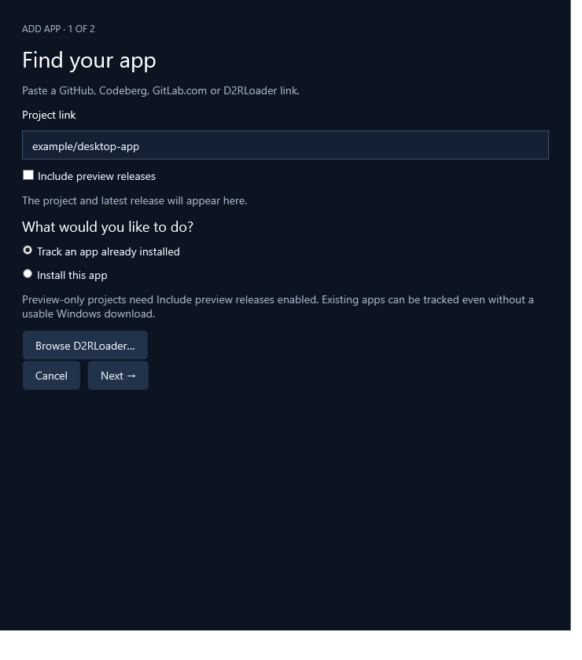
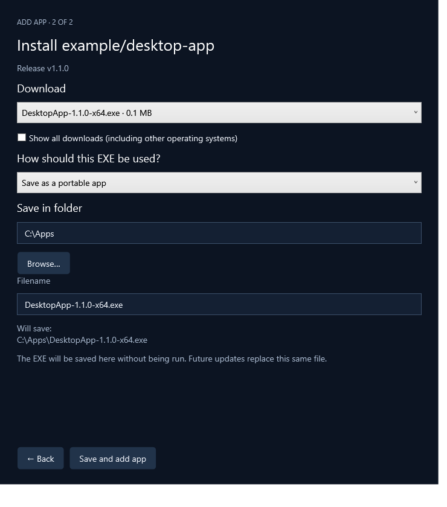
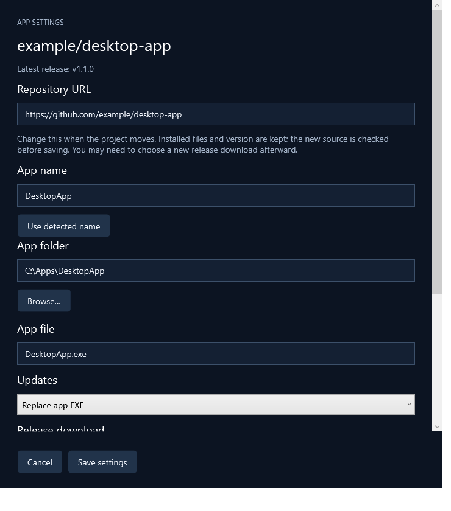
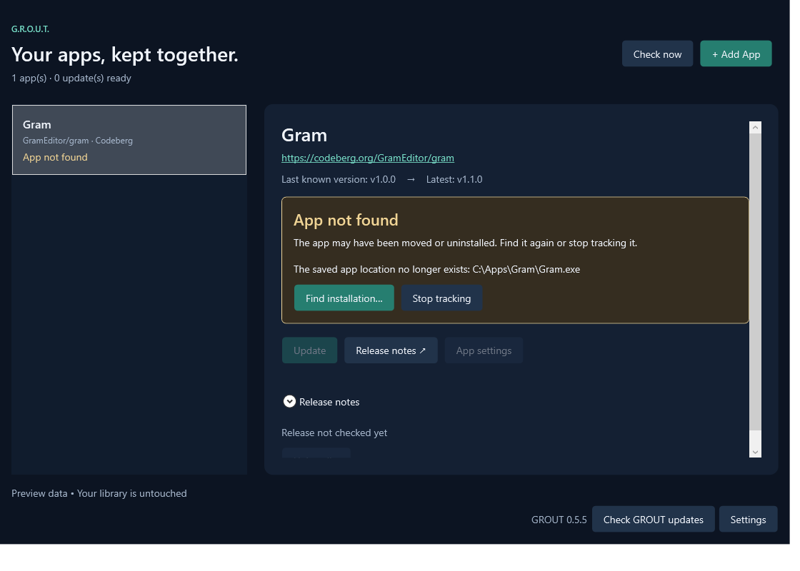

# Using GROUT

[← Back to README](../README.md)

## Add an app

Choose **Add App** and paste a [supported repository or release link](supported-sources.md). GROUT checks the project and shows its latest release. Enable **Include preview releases** for preview-only projects.

| Choice | What happens next |
| --- | --- |
| **Track an app already installed** | Choose its folder or EXE, check its version or enter one manually, then configure future updates. |
| **Install this app** | Choose a release download and how to install it. GROUT shows the relevant destination controls. |



*Screenshots use sample data.*

Tracking an existing app does not require a usable Windows download or successful version detection. A new installation requires a release asset. Adding a repository already in your library opens its existing entry.

### Portable EXE

Choose **Save as a portable app**, select **Save in folder**, and confirm the filename and full destination. **Save and add app** saves the EXE without running it. Future updates replace that exact file without a file-review screen.



GROUT records the release it saved. If the EXE supplies matching version metadata, automatic version reading is enabled. If metadata is missing or differs, GROUT retains the applied release and explains its source instead of treating the file save as a failure.

### Portable ZIP

Choose the parent folder. GROUT creates an app-named subfolder: choosing `C:\Apps` for Gram produces `C:\Apps\Gram`. The full destination is shown before confirmation; future updates use that app folder. Existing app locations are unchanged.

ZIP installs and updates extract directly into the configured app folder. Archive structure is preserved. Included files overwrite matching files without a review or conflict dialog; files absent from the archive remain unchanged.

### Installer

GROUT asks before running the selected EXE/MSI. The installer controls its own destination.

Before launch, GROUT snapshots Windows installed-app registrations. After the installer returns, it looks for matching new/changed registrations, favoring exact names and a current version. A clear completed installation is added and setup closes automatically. Unregistered or ambiguous installations need a location/version choice on the completion screen. **Find installation** retries without rerunning the installer.

Installer exit alone does not prove success. Some installers launch another process, use unusual names or install under another user's profile. A configured existing app is not silently redirected to a different folder during an update.

Cancelling setup does not add an app to the library or undo an installation already performed. Pending downloads can remain available for retrying.

## Configure future updates

**App settings** has one **App folder** field. For portable EXEs, **App file** is a filename; GROUT derives and displays the full replacement path. You can edit the app's display name here too.



| Update method | Behavior |
| --- | --- |
| **Replace app EXE** | Replace the configured portable EXE without an overwrite-review step. Close the app first. |
| **Run installer** | Download the EXE/MSI and ask before launching it. The installer chooses its destination. |
| **Extract ZIP into app folder** | Validate and extract all archive files, overwriting matching files automatically. |
| **Download only** | Open the package folder so you can install/copy it yourself. Then recheck or mark the installed version. |

An EXE's extension does not reveal whether it is an installer or a portable app; choose its intended use explicitly. Other app formats, including MSIX and 7z, use manual handling.

The selected download is remembered across version-number changes when the same filename family and architecture can be matched. Renamed or ambiguous assets require another selection in App settings. **Show all downloads** exposes files hidden by the normal [Windows filter](supported-sources.md#windows-downloads).

ZIP updates overwrite every included file, including matching settings/save files. Files absent from the archive are left unchanged. There is no file-selection screen.

Temporary rollback copies protect a file update internally while it is applied; there is no backup setup or backup-review screen. Completed updates **do not retain recovery backups**. If an operation cannot roll back safely, recovery information is retained for troubleshooting.

## Installed versions


EXE detection reads `ProductVersion`, falling back to `FileVersion`, without executing the file. For a folder, GROUT tries:

1. `release-manifest.json`
2. `vrmod-manifest.json`
3. A single top-level EXE, excluding installer/updater/crash-handler names

There is no recursive scan. A selected JSON manifest must contain a top-level `release_tag` or `version` string. Under **Advanced settings**, you can choose a separate version file while keeping the app folder as the update destination. A selected Windows registration can supply a clearly labeled one-time version fallback if file metadata is unavailable.

With automatic version reading enabled, versions are checked during release checks, every minute while running, and when returning to the window. In manual mode, those background checks verify that the saved location still exists without replacing the manually recorded version. Unreadable metadata preserves the last known version and shows an unverified state. Detection reads the version source, not the integrity of every installed file.

Common numeric differences such as `1.0.36.0` versus `hub-1.0.36` are normalized. Original strings remain visible; preview/channel suffixes are not discarded. Recognizable numeric downgrades are blocked. Other naming differences may appear as **Different release available** rather than being guessed into an order.

Use **Installed version** to recheck once, enter a version, or **Mark latest as installed**. Manual marking pauses automatic detection. A manual **Recheck version** reads once; enable **Read installed version automatically** in App settings to resume continuous reading.

### When an app disappears

GROUT checks saved locations even for manually tracked apps. Missing locations show **App not found**, with **Find installation** and **Stop tracking** as the main choices. Update, uninstall and version editing are disabled until the location is resolved. The previous version stays labeled as the last known version.



## Checks, tray and startup

In **Settings**, choose **Manual only**, **Every hour**, **Every 6 hours**, or **Every day** for tracked-app release checks. Daily is the default. Due checks run on launch and after wake. Source-specific rate-limit/access pauses survive restarts.

Closing the window leaves GROUT in the tray. Double-click the icon to reopen it, or right-click for **Open**, **Check now**, **Settings** and **Exit**. Exit stops checking.

Notifications announce new app/release tags once. **Quiet mode** suppresses them without creating a later backlog. Windows notification and Do Not Disturb settings can also suppress display.

**Start GROUT with Windows** is optional and starts hidden in the tray at sign-in, using the current user's startup registry entry. Keep the EXE in a permanent folder first. After moving or renaming it, toggle the startup setting off and on to save its new path.

## Update GROUT itself

GROUT checks this repository's stable releases on startup and daily, separately from the tracked-app schedule. Turn this off with **Check for GROUT updates automatically (daily)** in Settings, or use **Check GROUT updates** manually. The GROUT version and update controls sit immediately to the left of **Settings** at the bottom right of the main window.

Choose **Update and restart** when a newer release is available. GROUT verifies the EXE against the exact release SHA-256 checksum, prepares a helper, closes the running instance, replaces its EXE and relaunches it. Library and settings remain intact. Protected folders may need a manual update; no silent elevation is attempted.

Self-updates require no credentials or GitHub CLI. Previews and downgrades are excluded. Version 0.4.x needs one manual upgrade to 0.5.0 because it does not contain the self-updater.

## Uninstall or stop tracking

| Action | Effect |
| --- | --- |
| **Uninstall…** for a registered app | Launches the matched Windows uninstaller and removes the library entry after its registration and any known EXE confirm removal. If no unique match exists, opens Windows Installed apps and watches the saved location. |
| **Uninstall…** for a portable EXE | Moves only the confirmed EXE to the Recycle Bin, then removes its library entry. |
| **Uninstall…** for a portable ZIP app | Moves the confirmed app folder and contents to the Recycle Bin, then removes its library entry. Check that the folder belongs only to that app. System/common shared folders are blocked. |
| **Stop tracking** | Removes the library entry without uninstalling the app. |

Cancelled, failed or unconfirmed removals retain the entry. Pending confirmation survives a restart and is checked when GROUT regains focus and during its background tick. **Keep tracking** stops waiting; it does not cancel a running Windows uninstaller. Entries already left behind by older GROUT versions can be removed with **Stop tracking**.

For an **App not found** entry, Stop tracking asks to remove the missing library entry. It does not claim installed files or backups remain. Apps removed outside GROUT continue to offer Find installation and Stop tracking rather than being silently dropped.

## Storage and cleanup

GROUT retains its original data-folder name for compatibility:

```text
%LOCALAPPDATA%\ReleaseDock
```

| Item | Purpose and retention |
| --- | --- |
| `apps.json` | Tracked apps, names, paths, versions, cached release metadata and notification state |
| `settings.json` | Check schedules, quiet mode and preferences |
| `downloads/` | Pending/manual installation payloads; completed downloads are removed when safe |
| `staging/` | Temporary ZIP extraction files, cleaned automatically |
| `backups/` | Temporary rollback/recovery data; completed backups are removed |
| `self-update/` | Temporary GROUT update workspaces, removed after a successful restart; interrupted repair data can remain |

Back up `apps.json` and `settings.json` to preserve configuration. Cleanup also removes obsolete files from older builds; locked files can wait for a later pass.

The single EXE includes .NET. Native runtime components extract automatically into the .NET runtime cache at launch, separately from GROUT's data folder.

### Stable executable name

Download **GROUT.exe**. Its filename stays the same as the installed version changes. The version is shown inside GROUT and in the file properties.

The first self-update from an older `GROUT-<version>-win-x64.exe` installation moves it to `GROUT.exe` in the same folder. Matching startup, desktop, Start menu and taskbar shortcut entries are repaired after the new app confirms healthy startup; then the old EXE is removed. Custom shortcuts elsewhere may need updating manually. If another GROUT.exe already exists in the folder, the update stops before closing the old instance and leaves both files unchanged.

A separately labeled versioned release asset is an identical compatibility copy for older self-updaters. Choose GROUT.exe for a new download.

## App names and repository moves

The selected app shows its full repository URL beneath its name; click it to open the project. In App settings, edit **Repository URL** if the project moves, including to another supported provider. GROUT verifies the new project and rejects duplicates before saving. Installed files, destination and installed version are retained, while the old source's release/download selection is cleared. Choose the appropriate download from the new source afterward.

Suggested app names remain automatic and refresh when the install location changes. Typing a custom name makes it an explicit override. **Use detected name** clears the override and returns to the current app's name. A shared parent folder is not used to borrow an unrelated program's identity. Overrides saved by older versions are preserved until you reset them, so intentional custom names are not lost.
